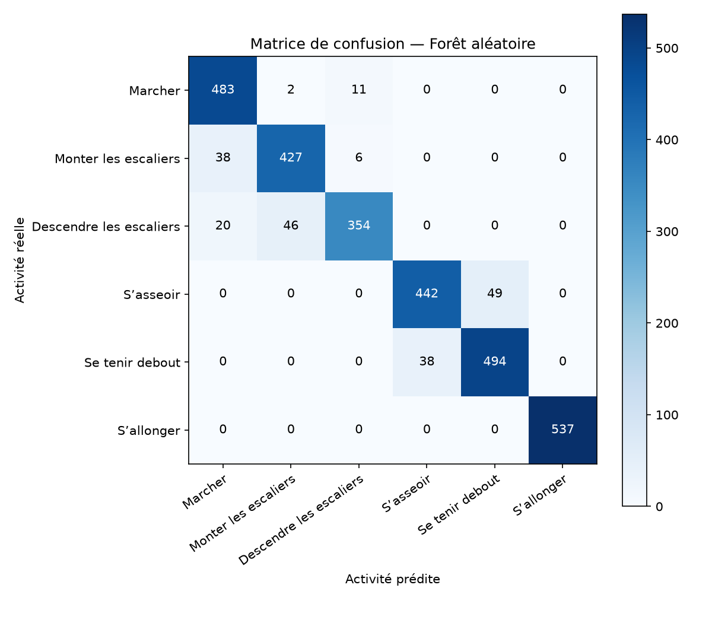
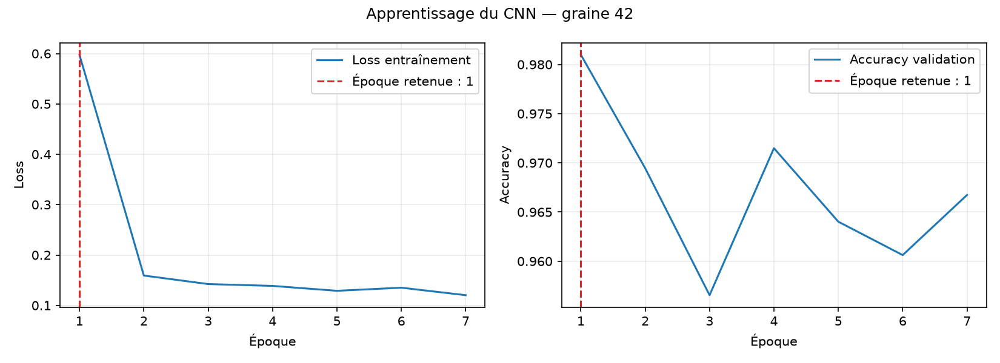

# Reconnaissance d’activités humaines avec UCI HAR 📱

Un smartphone dans une poche, des mouvements captés en continu… et une question toute simple : **est-ce qu’un modèle peut deviner si l’on marche, monte les escaliers ou se repose, juste grâce aux capteurs ?**

Ce projet explore deux façons de s’y prendre et compare leurs résultats :

- **Les modèles classiques** partent des 561 caractéristiques déjà préparées dans UCI HAR. On essaie une SVM et une forêt aléatoire.
- **Un réseau de neurones 1D (CNN)** apprend directement à partir des signaux bruts de l’accéléromètre et du gyroscope : 9 canaux observés sur 128 instants.

Les deux approches utilisent les partitions officielles `train` et `test`, pour que la comparaison reste cohérente. Le programme affiche les scores, prépare des matrices de confusion et garde une trace de chaque lancement. Pas besoin d’aller chercher les données à la main : elles sont téléchargées au premier lancement.

## Les activités au programme

🚶 Marcher · ⬆️ Monter les escaliers · ⬇️ Descendre les escaliers · 🪑 S’asseoir · 🧍 Se tenir debout · 🛌 S’allonger

## Démarrage 🚀

Python 3.10 ou une version plus récente est recommandé. Dans un terminal PowerShell ouvert dans le dossier du projet :

```powershell
python -m venv .venv
.\.venv\Scripts\Activate.ps1
python -m pip install -e ".[test]"
python -m pytest -q
python -m har_activity --epochs 30
```

Par défaut, les trois modèles sont entraînés avec cinq graines (`42 43 44 45 46`). Pour en choisir quelques-unes :

```powershell
python -m har_activity --seeds 42 43 44
```

L’exécution complète peut prendre du temps sur CPU : cinq graines, deux entraînements du CNN par graine et 300 arbres pour la forêt. Pour un essai rapide, utilisez `--seeds 42` ou `--epochs 2`. L’ancienne option `--seed` reste disponible pour lancer une seule graine.

```powershell
python -m har_activity --epochs 2 --seeds 42
```

## Résultats 📊

`outputs/metrics.csv` résume l’accuracy et le F1 macro sur les graines lancées. L’écart-type donne une idée de la variation des scores d’une graine à l’autre.

La SVM et son `StandardScaler` sont déterministes : leur écart-type sera donc nul, non pas parce qu’ils sont particulièrement stables, mais parce qu’ils ne comportent pas d’aléa lié à la graine. La forêt aléatoire et le CNN, eux, varient avec la graine.

| Modèle | Accuracy moyenne ± écart-type | F1 macro moyen ± écart-type |
|---|---:|---:|
| SVM | 0,9549 ± 0,0000 | 0,9540 ± 0,0000 |
| Forêt aléatoire | 0,9294 ± 0,0012 | 0,9275 ± 0,0012 |
| CNN 1D (signaux bruts) | 0,9196 ± 0,0043 | 0,9208 ± 0,0046 |

Les matrices de confusion (`outputs/confusion_*.png`) et la courbe du CNN (`outputs/courbes_cnn.png`) sont enregistrées dans `outputs/`. Les matrices correspondent à la première graine ; la courbe montre la loss d’entraînement et l’accuracy de validation du CNN pour cette même graine. Le journal `outputs/journal_experiences.csv` conserve les résultats individuels, une ligne par modèle et par graine.

<p align="center">
  
</p>
<p align="center">Matrice de confusion de la SVM — première graine de l’expérience (42 par défaut).</p>

<p align="center">
  
</p>
<p align="center">Matrice de confusion de la forêt aléatoire — première graine de l’expérience (42 par défaut).</p>

<p align="center">
  
</p>
<p align="center">Matrice de confusion du CNN 1D — première graine de l’expérience (42 par défaut).</p>

<p align="center">
  
</p>
<p align="center">Courbes d’apprentissage du CNN — première graine de l’expérience (42 par défaut).</p>

Pour mettre à jour ces images dans PowerShell après une expérience, copiez les fichiers générés :

```powershell
copy outputs\confusion_*.png docs\images\
copy outputs\courbes_cnn.png docs\images\
```

Faites-le seulement après avoir arrêté les réglages et retenu la version finale des résultats ; les images resteront ainsi cohérentes avec le tableau ci-dessus.

Le F1 macro accorde autant d’importance à chacune des six activités. Il complète l’accuracy et aide à repérer les classes sur lesquelles un modèle reste moins à l’aise.

### Quel modèle est le meilleur ?

Sur ces résultats, la SVM obtient le meilleur F1 macro moyen. La forêt et le CNN sont plus proches l’un de l’autre ; le choix dépend aussi de ce que vous recherchez, car le CNN fait moins d’erreurs que la forêt sur les activités en mouvement.

## Analyse

Sur la première graine (42), les trois modèles butent sur la même paire : **assis** et **debout**. C'est la confusion dominante du CNN (190 erreurs sur 243), mais aussi de la forêt (87) et de la SVM (65). **S'allonger** est reconnu presque parfaitement par tous.

Le CNN a un profil à part : sur les activités en mouvement (marcher, monter, descendre), il fait moins d'erreurs que la SVM et la forêt (44 contre 65 et 123). Son retard sur la SVM vient donc surtout d'assis/debout.

Sur cinq graines, la SVM reste en tête (F1 macro ≈ 0,954), suivie de la forêt (≈ 0,927) puis du CNN (≈ 0,921). L'écart entre la SVM et le CNN dépasse largement la variation entre graines ; celui entre la forêt et le CNN est plus mince. Les matrices ne portent que sur la graine 42 et sur les neuf sujets du test officiel : le détail des confusions (par exemple le sens d'une confusion) peut changer d'une graine à l'autre.

*Piste, pas une conclusion* : les 561 caractéristiques préparées contiennent des informations sur l'orientation de la gravité, qui peuvent aider à séparer assis et debout. Le CNN doit les retrouver seul à partir des signaux. À vérifier plutôt qu'à affirmer.

## Les coulisses, en quelques mots 🔍

1. Le programme récupère l’archive UCI HAR et lit les fichiers nécessaires directement depuis celle-ci.
2. La SVM et la forêt aléatoire travaillent sur les caractéristiques préparées par les auteurs du jeu de données.
3. Le CNN reçoit les neuf signaux bruts. Une partie du train sert à choisir le nombre d’époques, en réservant des sujets entiers pour la validation. La standardisation est calculée sur les données d’entraînement seulement ; le modèle final est réentraîné sur tout le train avant l’évaluation sur le test officiel.
4. Les trois modèles sont évalués avec plusieurs graines. Les scores, images et détails de chaque essai sont enregistrés pour rendre la comparaison plus fiable.

Le CNN utilise automatiquement CUDA si un GPU compatible est disponible ; sinon, il fonctionne sur CPU. Dans ce cas, l’entraînement peut prendre un peu plus de temps.

## Plan du projet

```text
src/har_activity/
  data.py          Téléchargement et lecture des données
  models.py        Modèles classiques
  neural.py        CNN, validation par sujet et courbes
  experiment.py    Comparaison multi-graines et résultats
  __main__.py      Commande de lancement
tests/             Tests sur les données et le CNN
```

## Le jeu de données

Anguita, D. et al. (2013). *A Public Domain Dataset for Human Activity Recognition Using Smartphones*. ESANN.

Jeu de données : [UCI Machine Learning Repository — Human Activity Recognition Using Smartphones](https://archive.ics.uci.edu/dataset/240/human+activity+recognition+using+smartphones).

Les données sont téléchargées sur la machine au lancement et ne sont pas incluses dans le dépôt.

## Journal de bord — l’aventure jusqu’ici 📝

**Le point de départ.** L’idée est de faire parler les capteurs du smartphone : leurs mouvements contiennent peut-être assez d’indices pour reconnaître une activité du quotidien. Un bon petit défi, entre traitement du signal et apprentissage automatique !

**Le choix de comparaison.** Plutôt que de n’essayer qu’un seul modèle, nous mettons face à face deux approches complémentaires : des méthodes classiques avec des caractéristiques conçues à l’avance, et un CNN qui reçoit directement les signaux. L’objectif est de comprendre ce que chacune apporte, pas seulement de chercher le plus gros score.

**Le garde-fou.** Le test officiel est réservé à l’évaluation finale. Le CNN choisit son nombre d’époques à partir d’une partie du train, pour éviter de régler le modèle en fonction des réponses du test. C’est un détail méthodologique important pour que la comparaison soit plus honnête.

**Le suivi des essais.** À chaque lancement, les scores sont ajoutés à `outputs/journal_experiences.csv`. Ce fichier est le journal chiffré des expériences ; cette section du README, elle, raconte les choix et les étapes du projet. Les résultats ci-dessus viennent de l’exécution du projet avec les graines 42 à 46.

**Plusieurs graines.** Les modèles sont maintenant lancés cinq fois par défaut, avec des graines différentes. Cela permet de comparer les moyennes sans oublier la variabilité d’un lancement à l’autre. Les matrices de confusion sont gardées pour la première graine afin de rester lisibles.

**Validation par sujet.** Les sujets de validation sont séparés des sujets d’entraînement. Comme les fenêtres d’une même personne peuvent se ressembler, cette séparation donne une indication plus prudente de la capacité du CNN à généraliser à des personnes qu’il n’a pas vues. Cette validation par sujet n’est pas stratifiée : certaines classes peuvent être peu représentées dans le groupe de validation. C’est le compromis de cette séparation, qui privilégie des sujets distincts entre entraînement et validation.

**Les courbes du CNN.** La loss d’entraînement et l’accuracy de validation sont enregistrées à chaque époque. L’époque retenue est indiquée dans `outputs/courbes_cnn.png`, pour rendre le choix plus facile à comprendre.

**La suite.** Commencez par installer les dépendances et lancer les tests, puis faites un essai court avec `--epochs 2 --seeds 42`. Quand tout fonctionne, lancez une expérience plus longue, comparez le F1 macro et observez les matrices. Vous pourrez ensuite tester d’autres réglages et noter dans le journal ce qui a changé et ce que vous avez appris.

**Premiers résultats.** La SVM arrive en tête, et le CNN ne dépasse pas les modèles classiques. Assis/debout reste la difficulté commune aux trois modèles.
